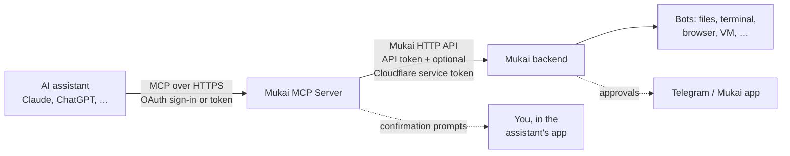

# Mukai MCP Server

**Control a [Mukai](https://github.com/munashesydney/mukai) installation from any AI assistant that speaks
the [Model Context Protocol](https://modelcontextprotocol.io) (MCP), such as Claude, ChatGPT, Claude Code or
Cursor, from anywhere, safely.**

Mukai already has a complete HTTP API. This server exposes that API as **143 MCP tools**. It adds
the things a remote AI assistant needs on top: a sign-in flow, human-in-the-loop approvals,
per-workspace permission rules, and security hardening. **It doesn't modify Mukai.**

Author: **Sindiso Matikiti** · License: [MIT](LICENSE)

---

## Contents

- [What it does](#what-it-does)
- [How it works](#how-it-works)
- [Features](#features)
- [Approvals and permissions](#approvals-and-permissions)
- [Security](#security)
- [Quick start](#quick-start)
- [Configuration](#configuration)
- [Deployment](#deployment)
- [Connecting an AI assistant](#connecting-an-ai-assistant)
- [Limitations](#limitations)
- [Troubleshooting](#troubleshooting)
- [Development and tests](#development-and-tests)
- [Project structure](#project-structure)
- [License](#license)

---

## What it does

Connect your AI assistant once, and it can work with your whole Mukai system in plain language:

> "List my Mukai workspaces." · "Ask the Valorious bot to draft the launch plan." · "What's waiting for
> my approval?" · "Approve the file write from Ada." · "Create a tester bot and give it the brief." ·
> "Show me what the bot changed in `app.tsx`."

- **The assistant acts as a manager. Mukai's bots are the team.** The assistant plans, briefs bots,
  supervises their work, reviews results and handles approvals. The bots do the hands-on work:
  code, files, terminal, browser and VM.
- **Two-way approvals.** Requests raised in the Mukai app can be answered through the assistant, and
  requests raised by work the assistant started show up in the Mukai app and Telegram as usual.
- **You decide how much the assistant may decide on its own**, per workspace, using Mukai's own
  approval modes plus a third, "I own it", and fine-grained rules.

## How it works



The assistant gets things done in two ways:

1. **It asks a Mukai bot.** For example: "open the browser and check the exchange rate". The bot
   does the work with its own model and tools, under **Mukai's approval system**.
2. **It calls Mukai directly.** It can manage workspaces, bots, memory, providers and so on, and
   control an already-open browser tab in a local workspace. Mukai treats these calls as the owner,
   so **this server's own rules** are what gate them.

Chat replies stream from Mukai. The chat tools collect the stream and return the final text, the
tool activity and anything waiting for a decision. Mukai runs live on the backend: if the
assistant disconnects, the run continues, and sending the same `requestId` again reattaches to it.
Approvals raised by **sub-bots** that the bot delegated to are caught too, within about two seconds.

## Features

| Area | What the assistant can do |
| --- | --- |
| **Chat** | Talk to bots, private chats, spaces and bot threads; retry, stop, queue and steer follow-ups |
| **Workspaces** | List, create, update, delete, timezone; start/stop/size VM computers |
| **Bots** | List, create, partially update, change model, delete; messages, files, artifacts, attachments |
| **Conversations** | Messages, outputs, terminal snapshots, trajectories, artifacts, file-change diffs |
| **Approvals** | Everything waiting (from the app, Telegram, pursuits or MCP); approve, reject, answer questions |
| **Permissions** | Per-workspace MCP mode and rules (`mukai_get_mcp_permissions`, `mukai_set_mcp_rule`, …) |
| **Pursuits** | List, inspect, pause/resume, run now, retry, workpad |
| **Memory** | Snapshot, search, context, correct/forget facts, settings, import/export |
| **Providers** | List, add, update, test, models, ChatGPT sign-in |
| **Skills and custom code** | Skills; custom tools, routes and jobs; environment variables |
| **Browser** | Sessions, screenshots (the assistant can look at them), navigate/click/type in an open tab |
| **Inbox and settings** | Notifications, failures, profile, appearance, limits, updates, Telegram |

The full route-by-route inventory, generated from the code, is in
**[docs/MUKAI_API.md](docs/MUKAI_API.md)**.

## Approvals and permissions

### Modes (per workspace)

| Mode | Bot tool requests (files, terminal, browser…) | Bot questions and yes/no go-aheads | The assistant's sensitive actions |
| --- | --- | --- | --- |
| **ask-for-approval** *(default)* | You decide | You decide | You confirm |
| **full-access** (like Mukai's) | The assistant decides | You decide | You confirm |
| **i-own-it** | The assistant decides | The assistant decides | You confirm |

### Rules (fine-tuning)

Rules say `allow` or `ask` for one category and override the mode. They can apply to one
workspace or to all of them.

- **Bot requests:** `files-read`, `files-write`, `files-overwrite`, `terminal`, `browser`,
  `computer-use`, `web`, `bots`, `pursuits`, `custom-code`, `custom-tools`, `questions`, `yes-no`,
  `other`.
- **The assistant's own actions:** `delete`, `providers`, `custom-code`, `secrets`, `skills`,
  `memory-edit`, `workspace-setup`, `telegram`, `settings`, `browser-control`, `raw-api`.

Examples: *"I own it, but never approve terminal commands for me"* → `requests.terminal = ask`.
*"In my sandbox, the assistant may delete things"* → `actions.delete = allow`.

**Who can change them:**
- **You, through the assistant.** Making anything looser requires your confirmation and doesn't
  take effect until you confirm. Making things stricter never asks.
- **The operator, in a lockable rules file** (`MCP_RULES_FILE`; see [`rules.example.json`](rules.example.json)).
  Locked entries can't be changed through MCP.

### How you decide

- **In the assistant's app.** Where the client supports MCP confirmation prompts (elicitation), you
  see a box built from **Mukai's own record** of the request, never from the assistant's
  description, and your choice is applied.
- **In Telegram or the Mukai app.** These always work. Mukai sends every pending request to
  Telegram, wherever it started, and whoever answers first wins.

Full details: **[docs/SECURITY.md](docs/SECURITY.md#two-kinds-of-permission)**.

## Security

Safe by default. Highlights:

- **Sign-in:** OAuth 2.1 with PKCE and an owner-password login page, plus an optional static
  token (32+ characters). Access tokens last 1 hour; refresh tokens last 30 days, rotate on every
  use, and **reuse of an old one ends the sign-in**. Only allowlisted apps (Claude by default) can
  register.
- **The assistant can't approve on your behalf** unless your mode or rules say so.
  Sensitive actions (deleting, providers, custom code, secrets…) need your confirmation.
- **Prompt-injection resistant:** everything returned from Mukai is labelled as untrusted data,
  and confirmation prompts come from Mukai's records rather than from model text.
- **Hardened transport:** path-traversal guard, Host allowlist, request size limits, and lockout
  after repeated failures. Lockout tracks each visitor's real address, including behind Cloudflare.
- **Secrets stay put:** Mukai's API token never leaves the server, the route that would reveal it
  is blocked, keys are redacted from logs and prompts, and tokens are stored only as hashes.
- **Audit log** of every tool call and decision.
- **Cloudflare Zero Trust:** supported with a revocable service token.

Threat model, every setting and a deployment checklist: **[docs/SECURITY.md](docs/SECURITY.md)**.
To report a vulnerability, see [Reporting a vulnerability](docs/SECURITY.md#reporting-a-vulnerability).

## Quick start

Requires **Node.js 20+** and a running Mukai backend.

```sh
git clone https://github.com/matikitisindiso-sys/mukai-MCP.git
cd mukai-MCP
npm ci
npm run build

export MUKAI_API_URL=http://127.0.0.1:47831      # your Mukai backend
export MUKAI_API_TOKEN=...                        # Mukai → Settings → API
export MCP_AUTH_TOKEN=$(openssl rand -hex 32)     # what clients send to this server
npm start                                          # MCP endpoint: http://localhost:3333/mcp
```

Check it: `curl http://localhost:3333/health` → `{"status":"ok",…}`.

## Configuration

All settings are environment variables. See [`.env.example`](.env.example) for a template.

**Connecting to Mukai**

| Variable | Description |
| --- | --- |
| `MUKAI_API_URL` | Mukai's API address. Same machine: `http://127.0.0.1:47831`. Remote (behind `mukai serve` and a tunnel or proxy): `https://your-mukai-domain/api`. |
| `MUKAI_API_TOKEN` | Mukai's API token (**Settings → API**). |
| `MUKAI_CF_ACCESS_CLIENT_ID` / `MUKAI_CF_ACCESS_CLIENT_SECRET` | Cloudflare Access service token, if Mukai is behind Zero Trust. |
| `MUKAI_CHAT_WAIT_SECONDS` | How long chat tools wait before returning. Default `55`; keep it below your client's timeout. |

**Access to this server**

| Variable | Description |
| --- | --- |
| `MCP_PUBLIC_URL` | Public HTTPS address of this server, e.g. `https://mcp.example.com`. Required for OAuth. |
| `MCP_OWNER_PASSWORD` | Owner password for the OAuth login page (12+ characters). Turns OAuth on. |
| `MCP_AUTH_TOKEN` | Static bearer token (32+ characters), e.g. for Claude Code. Optional when OAuth is on. |
| `MCP_OAUTH_REDIRECT_HOSTS` | Apps allowed to sign in. Default `claude.ai,claude.com`; add `chatgpt.com` for ChatGPT. |
| `MCP_ALLOWED_HOSTS` | Host allowlist, e.g. `mcp.example.com`. |
| `MCP_TRUST_PROXY` | `cloudflare` behind a Cloudflare Tunnel, a number of proxies, `true`, or `false` (default). |
| `PORT` / `HOST` | Listener. Default `3333` / `0.0.0.0`. |

**Permissions and policy**

| Variable | Description |
| --- | --- |
| `MCP_APPROVAL_MODE` | Default mode: `ask-for-approval` (default), `full-access` or `i-own-it`. |
| `MCP_RULES_FILE` | Operator rules file (JSON, lockable). |
| `MCP_SENSITIVE_TOOLS` | `confirm` (default), `disable` or `allow`. |
| `MCP_TOOL_PROFILE` | `standard` (143 tools, default), `read-only` (56) or `full` (144, adds a raw API tool). |
| `MCP_STATE_FILE` / `MCP_OAUTH_STATE_FILE` | Where modes, rules and sign-ins are saved (`data/`). Keep them on persistent storage. |

The complete list, including session limits, timeouts and audit logging, is in
[docs/SECURITY.md](docs/SECURITY.md#configuration).

## Deployment

The server runs as **a single container**, built from the included `Dockerfile`. Sessions live in
memory, so run **one instance**, or use sticky sessions. Mount a **persistent volume at
`/app/data`**.

```sh
docker build -t mukai-mcp .
docker run -p 3333:3333 -v mukai-mcp-data:/app/data \
  -e MUKAI_API_URL=https://mukai.example.com/api -e MUKAI_API_TOKEN=... \
  -e MCP_PUBLIC_URL=https://mcp.example.com -e MCP_OWNER_PASSWORD=... \
  mukai-mcp
```

### Coolify with a Cloudflare Tunnel (reference setup)

1. **Coolify:**
   - **Create the app:** new resource from this repository, branch `main`, build pack **Dockerfile**, port `3333`.
   - **Domain:** `http://mcp.example.com`. Use `http`: Cloudflare provides HTTPS to visitors, and this avoids certificate loops inside Coolify.
   - **Storage:** add a volume at `/app/data`.
   - **Health check:** the Dockerfile's built-in one is used automatically.
2. **Environment:** `MUKAI_API_URL`, `MUKAI_API_TOKEN`, `MCP_PUBLIC_URL=https://mcp.example.com`,
   `MCP_OWNER_PASSWORD`, `MCP_ALLOWED_HOSTS=mcp.example.com`, `MCP_TRUST_PROXY=cloudflare`.
3. **Cloudflare Tunnel:** route `mcp.example.com` to Coolify's proxy (a wildcard route also works).
4. **Cloudflare Access:**
   - `mcp.example.com`: a **Bypass** policy. AI apps can't complete Cloudflare's login, and this server has its own.
   - Mukai's domain: keep your login policy, and add a **Service Auth** policy for the service token in `MUKAI_CF_ACCESS_CLIENT_ID/SECRET`. **Don't use Bypass on Mukai.**
5. **Firewall:** make sure the server is only reachable through Cloudflare. With a Tunnel, no inbound ports are needed.

After deploying, the log line should read
`… [trustProxy=cloudflare oauth=on … cloudflareAccess=service-token …]`, and
`https://mcp.example.com/health` should return `{"status":"ok"}`.

## Connecting an AI assistant

**Claude app (custom connector)**

1. **Settings → Connectors → Add custom connector**, URL `https://mcp.example.com/mcp`. No token
   is needed.
2. A **Connect to Mukai** page opens. Enter the owner password and press **Allow**.
3. Ask: *"List my Mukai workspaces."*

**ChatGPT** (where your plan supports MCP connectors / Developer mode): add `chatgpt.com` to
`MCP_OAUTH_REDIRECT_HOSTS`, then add a connector with the same URL and OAuth sign-in.

**Claude Code**

```sh
claude mcp add --transport http mukai https://mcp.example.com/mcp \
  --header "Authorization: Bearer $MCP_AUTH_TOKEN"
```

**Local stdio clients** (the client starts the server itself):

```json
{
  "mcpServers": {
    "mukai": {
      "command": "node",
      "args": ["/path/to/mukai-MCP/dist/index.js", "--stdio"],
      "env": { "MUKAI_API_URL": "http://127.0.0.1:47831", "MUKAI_API_TOKEN": "..." }
    }
  }
}
```

**Signing everyone out:** change `MCP_OWNER_PASSWORD` and redeploy, or run
`node dist/index.js --revoke-oauth`.

## Limitations

- **What needs a bot.** The assistant can't open a new browser, browse workspace files, run
  terminal commands or see a VM's screen directly; Mukai's API doesn't offer these. It asks a
  bot instead, under Mukai's approvals.
- **Direct browser control** works for an already-open tab in **local** workspaces. In VM
  workspaces the browser runs inside the VM; use a bot there.
- **The assistant only knows what it asks for.** It finds out automatically about anything it
  started, including sub-bots. Other pending requests appear when it checks, e.g. when you ask
  "anything waiting for me?". Telegram remains the real-time alert.
- **Confirmation prompts depend on the client.** Where a client can't show them, decisions that
  need you go to Telegram or the Mukai app, and sensitive actions are refused unless a rule allows
  them.
- **One instance per deployment,** because sessions are held in memory.

## Troubleshooting

| Symptom | Cause and fix |
| --- | --- |
| Cloudflare **"Forbidden"** page on the MCP domain | An Access application, often a wildcard, covers it. Add a **Bypass** application for the MCP domain. |
| Tools say **"Blocked before reaching Mukai"** | Cloudflare Access is stopping the server → Mukai hop. Add a **Service Auth** policy for the service token on Mukai's Access application, and check the Client ID and Secret. |
| Deployment rolled back, health check **403** | You're on an old version; update. `/health` now answers before the Host allowlist. |
| Pressing **Allow** on the login page does nothing | You're on an old version; update. |
| App sign-in fails right after **Allow** | Check the log for `oauth.registration_refused` and add that app's host to `MCP_OAUTH_REDIRECT_HOSTS`. |
| Everyone gets **429 Too many failed attempts** | Behind a proxy without `MCP_TRUST_PROXY`, everyone shares one address. Set `cloudflare` (Tunnel) or the proxy count. |
| Chat tool returns `timeout` | The bot is still working. Call again with the same `requestId` to keep waiting. |

## Development and tests

```sh
npm run build        # compile TypeScript to dist/
npm run dev          # run from source
npm test             # unit and browser tests (no Mukai needed)
```

| Suite | What it covers | Needs |
| --- | --- | --- |
| `npm test` (10) | Permission rules, operator locks, lockout behind Cloudflare, health check, login page in a real browser | Nothing |
| `test/e2e.mjs` (24) | Approvals in every mode, app-raised requests, sub-bots, rules, hardening | Mukai and `test/mock-llm.mjs` |
| `test/oauth.mjs` (9) | The full sign-in flow and attacks: bad callbacks, PKCE, code reuse, refresh-token theft, restarts, password change | Mukai |
| `test/cf-access.mjs` (5) | A Cloudflare Access gate in front of Mukai: no token, wrong token, right token with streamed chat | Mukai |

The end-to-end suites run against a real Mukai backend, with `test/mock-llm.mjs` as a fake
OpenAI-compatible model:

```sh
node test/mock-llm.mjs &
MUKAI_API_URL=http://127.0.0.1:47831 MUKAI_API_TOKEN=... \
MCP_URL=http://127.0.0.1:3333/mcp MCP_AUTH_TOKEN=... TEST_FOLDER=/tmp/empty-dir \
node test/e2e.mjs
```

After changing `src/endpoints.ts`, regenerate the API inventory with `node scripts/gen-api-doc.mjs`.

## Project structure

```
src/
  index.ts       HTTP and stdio entry point, sessions, sign-in checks, lockout
  tools.ts       Tool registration, approvals, chat streaming, permission enforcement
  endpoints.ts   Declarative map of Mukai's API routes to tools
  rules.ts       Modes, rule categories, operator and user rules, precedence
  oauth.ts       OAuth 2.1 provider and the owner login page
  security.ts    Policy, confirmations, redaction, audit log, lockout
  client.ts      Mukai API client (path guard, Cloudflare Access, streaming chat)
docs/
  SECURITY.md    Threat model, permissions, configuration, vulnerability reporting
  MUKAI_API.md   Generated inventory of Mukai's routes and their tools
test/            Unit, browser and end-to-end suites, plus a mock model
```

## License

[MIT](LICENSE) © 2026 Sindiso Matikiti.

Mukai itself is a separate project by its own authors:
[github.com/munashesydney/mukai](https://github.com/munashesydney/mukai). This server talks to it only
through its public HTTP API.
